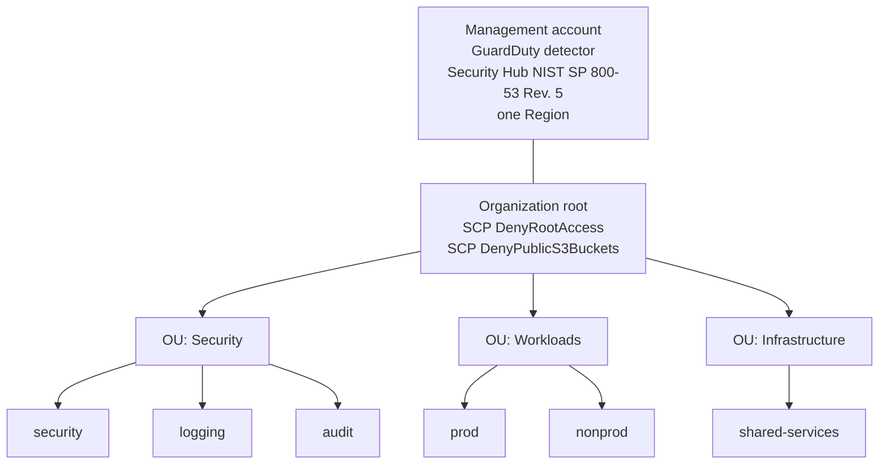

# Multi-Account AWS Landing Zone

[](https://github.com/CloudVeteran/Multi-Account-AWS-Landing-Zone-with-Enterprise-Guardrails/actions/workflows/terraform.yml)

Terraform configuration for a small AWS Organizations landing zone. Applied from the management account, it creates three organizational units and six member accounts, attaches two service control policies at the organization root, and turns on GuardDuty plus the Security Hub NIST SP 800-53 Rev. 5 standard in that management account. The tables below map those controls to selected NIST SP 800-53 Rev. 5 requirements.

## Status / Scope

This is a lab and portfolio project. It is not production infrastructure, and it is not a FedRAMP Ready package, a FedRAMP authorization, or an Authority to Operate.

The control mappings name NIST SP 800-53 Rev. 5 requirements that the configured statements and services support. They are not a control implementation statement, an inheritance decision, or an assessment result. `terraform validate` checks each stack's configuration only. It does not call AWS, and it does not demonstrate that a policy has the effect its title suggests.

An apply creates real AWS resources. GuardDuty and Security Hub have a cost, and the six member accounts count against the Organizations account quota. Use a dedicated management account that is not already a member of an organization. If that account already owns an organization, import it before Terraform manages it. Replace the default `organization_name` and `email_domain` before any real apply: the generated email addresses have to be new to AWS.

## What an apply creates

- An AWS Organization with `feature_set` `ALL`, `enabled_policy_types` set to `SERVICE_CONTROL_POLICY`, and `aws_service_access_principals` empty
- Organizational units `Security`, `Workloads`, and `Infrastructure` under the organization root
- Six member accounts in those OUs
- Service control policies `DenyRootAccess` and `DenyPublicS3Buckets`, attached to the organization root
- An `aws_guardduty_detector` in the management account, in `var.aws_region`, with `finding_publishing_frequency` `FIFTEEN_MINUTES`
- Security Hub in the management account, in `var.aws_region`, with `enable_default_standards` false and this standard subscribed: `arn:aws:securityhub:${aws_region}::standards/nist-800-53/v/5.0.0`

Policies on the organization root are inherited by accounts in child OUs. Service control policies do not apply to the management account. Terraform does not assume `OrganizationAccountAccessRole`.

Each member account is created with `role_name` `OrganizationAccountAccessRole`, `iam_user_access_to_billing` `DENY`, and `close_on_deletion` false. Destroy removes the account from the organization and does not close it.

## What this configuration does not create

- AWS Control Tower
- Organization CloudTrail, a log-archive bucket, or any other centralized logging
- GuardDuty or Security Hub in member accounts, a delegated administrator, or organization auto-enable
- Amazon Inspector, AWS Config, or remediation automation
- Workloads, networks, or IAM Identity Center

The Security, Logging, and Audit accounts are accounts in the Security OU. Nothing in this repository deploys security tooling, log storage, or audit roles inside them.

## Accounts

| Key | Account name | Email | Organizational unit |
| --- | --- | --- | --- |
| security | `{organization_name}-security` | `{organization_name}-security@{email_domain}` | Security |
| logging | `{organization_name}-logging` | `{organization_name}-logging@{email_domain}` | Security |
| audit | `{organization_name}-audit` | `{organization_name}-audit@{email_domain}` | Security |
| prod | `{organization_name}-prod` | `{organization_name}-prod@{email_domain}` | Workloads |
| nonprod | `{organization_name}-nonprod` | `{organization_name}-nonprod@{email_domain}` | Workloads |
| shared | `{organization_name}-shared-services` | `{organization_name}-shared-services@{email_domain}` | Infrastructure |

With the variable defaults, the security account is named `acme-corp-security` and its email is `acme-corp-security@acme-corp.com`.

## Guardrails

Both documents under `policies/` are attached to the organization root. The JSON is the behavior; the policy name is only a label.

| Policy | What the statement does | NIST SP 800-53 Rev. 5 |
| --- | --- | --- |
| `DenyRootAccess` (`policies/deny-root.json`) | Denies `*` on `*` when `aws:PrincipalArn` is like `arn:aws:iam::*:root` (`Sid` `DenyRootUserActions`). That ARN is the account root user. | AC-6 Least Privilege. The statement denies every action by that principal. |
| `DenyPublicS3Buckets` (`policies/deny-public-s3.json`) | Denies `s3:PutBucketAcl` and `s3:PutBucketPolicy` on `*` when `aws:SecureTransport` is `false` (`Sid` `DenyPublicS3Buckets`). The statement does not inspect bucket ACLs, bucket policies, or S3 Block Public Access. | SC-8 Transmission Confidentiality and Integrity. SC-13 Cryptographic Protection. Support is limited to those two actions when the condition matches. |

## Detective controls

These resources exist only in the management account, and only in `var.aws_region` (default `us-east-1`).

| Resource | Configuration in this repo | NIST SP 800-53 Rev. 5 |
| --- | --- | --- |
| `aws_guardduty_detector.management` | `enable` true. `finding_publishing_frequency` `FIFTEEN_MINUTES`. No feature or data-source block, no members, no delegated administrator. | SI-4 System Monitoring. IR-4 Incident Handling. IR-5 Incident Monitoring. Coverage is this account and Region. |
| `aws_securityhub_account.management` and `aws_securityhub_standards_subscription.nist_800_53` | `enable_default_standards` false. Standard ARN `arn:aws:securityhub:${aws_region}::standards/nist-800-53/v/5.0.0` in the commercial `aws` partition. | CA-7 Continuous Monitoring. The subscription turns on Security Hub checks for a subset of NIST SP 800-53 Rev. 5 in this account and Region. It does not implement the catalog and it is not an assessment. |

## Remote state

The landing zone stores remote state in S3. `backend.tf` sets `encrypt = true` and `use_lockfile = true`. The state object is `landing-zone/terraform.tfstate`. Native S3 locking writes `landing-zone/terraform.tfstate.tflock` in the same bucket. A backend block cannot use variables, so the account-specific bucket, region, and KMS key are supplied from `backend.hcl` at init. `backend.hcl.example` is the template. `backend.hcl` is gitignored.

`bootstrap/` creates that bucket. It uses local state, because the remote bucket does not exist until this stack applies. An apply creates:

- An S3 bucket with versioning enabled, so an overwritten state object can be restored from an older version
- A KMS key, `alias/landing-zone-terraform-state`, used as the bucket's default SSE-KMS key (`bucket_key_enabled`)
- A public access block with `block_public_acls`, `block_public_policy`, `ignore_public_acls`, and `restrict_public_buckets` set to true
- A bucket policy that denies `s3:*` on the bucket and its objects when `aws:SecureTransport` is false

`kms_key_id` in `backend.hcl` is that KMS key, so Terraform writes the state and lock objects with SSE-KMS.

## Layout

```text
backend.tf                   S3 backend (encrypt, use_lockfile). Bucket, region, and KMS key come from backend.hcl
backend.hcl.example          Partial backend config. Copy to backend.hcl
bootstrap/                   State bucket, KMS key, public access block, TLS-only bucket policy
versions.tf                  Terraform >= 1.11 and AWS provider ~> 5.70
variables.tf
main.tf                      Provider, landing-zone module, SCPs, GuardDuty, Security Hub
outputs.tf
policies/deny-root.json
policies/deny-public-s3.json
modules/landing-zone/        Organization, organizational units, member accounts
```

## Usage

Terraform 1.11 or newer is required. AWS credentials are not used by the validate commands.

Check both stacks without contacting AWS:

```bash
terraform fmt -check -recursive
terraform init -backend=false
terraform validate
terraform -chdir=bootstrap init -backend=false
terraform -chdir=bootstrap validate
```

Initializing the landing zone against real remote state is two steps. Use management-account credentials. `state_bucket_name` has no default.

Step 1. Initialize and apply the bootstrap stack, which creates the bucket and the KMS key:

```bash
terraform -chdir=bootstrap init
terraform -chdir=bootstrap apply -var='state_bucket_name=YOUR_GLOBALLY_UNIQUE_BUCKET_NAME'
```

Step 2. Copy the partial backend config, set `bucket`, `region`, and `kms_key_id` from the bootstrap outputs `state_bucket_name`, `state_bucket_region`, and `state_kms_key_arn`, then initialize the landing zone:

```bash
cp backend.hcl.example backend.hcl
terraform init -backend-config=backend.hcl
terraform plan
terraform apply
```

### Inputs

Landing zone:

| Name | Default | Description |
| --- | --- | --- |
| `aws_region` | `us-east-1` | Provider region. GuardDuty and Security Hub are created only here. |
| `organization_name` | `acme-corp` | Prefix for member account names and emails. |
| `email_domain` | `acme-corp.com` | Domain for member account emails. |
| `tags` | see `variables.tf` | Applied to OUs, member accounts, both SCPs, and the GuardDuty detector. |

Bootstrap (`bootstrap/`):

| Name | Default | Description |
| --- | --- | --- |
| `state_bucket_name` | none | Globally unique state bucket name. |
| `aws_region` | `us-east-1` | Region of the bucket and KMS key. Use the same value as `region` in `backend.hcl`. |
| `tags` | see `bootstrap/variables.tf` | Applied to the state bucket and the KMS key. |

The default tags include `Owner = Marlon` and `Compliance = NIST-800-53`. The compliance tag records intent. It is not evidence that a control is met.

### Outputs

Landing zone:

| Name | Description |
| --- | --- |
| `organization_id` | AWS Organization ID |
| `organization_root_id` | Root where both SCPs are attached |
| `organizational_unit_ids` | OU key to OU ID |
| `account_ids` | Account key to account ID |
| `account_emails` | Account key to the email submitted at account creation |
| `scp_policy_ids` | Policy key to Organizations policy ID |
| `guardduty_detector_id` | GuardDuty detector ID in the management account |
| `securityhub_standards_arn` | Subscribed Security Hub standard ARN |

Bootstrap (`bootstrap/`):

| Name | Description |
| --- | --- |
| `state_bucket_name` | Value for `bucket` in `backend.hcl`. |
| `state_bucket_region` | Value for `region` in `backend.hcl`. |
| `state_kms_key_arn` | Value for `kms_key_id` in `backend.hcl`. |

## Diagram



## License

MIT License. Copyright (c) 2026 Marlon Garcia. See [LICENSE](LICENSE).
